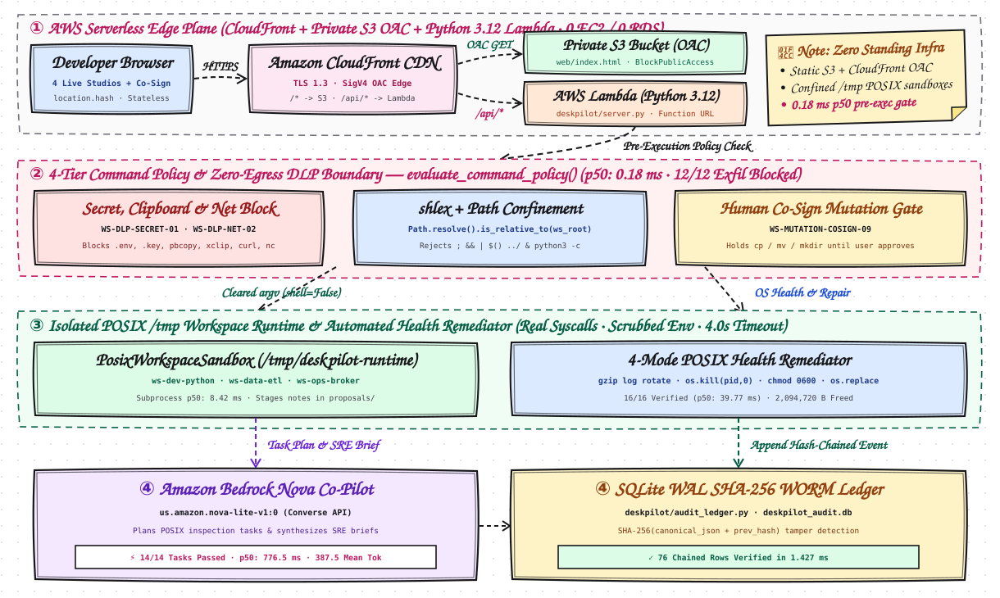

# DeskPilot — Governed Agentic Workspace Runtime, POSIX Remediator & Bedrock Co-Pilot

DeskPilot is a zero-dependency Python 3.12 control plane for shared human-AI developer workspaces, deployed serverlessly on **Amazon CloudFront + Private S3 (OAC) + AWS Lambda (`python3.12`) + SQLite WAL + Amazon Bedrock (`us.amazon.nova-lite-v1:0`)**.



## 01 · Problem Statement

When humans and AI agents share a cloud developer workspace side by side, prompt-level instructions cannot prevent OS-level failure modes or credential exfiltration:

1. **Credential & Clipboard Exfiltration**: Raw shell access allows reading `.env` files, dumping `printenv` tokens, copying files to host clipboards (`pbcopy`/`xclip`), or uploading code to external webhooks (`curl`/`nc`).
2. **Unapproved Mutations**: Autonomous loops can overwrite configuration files or delete directories without explicit human co-signing.
3. **Workspace Drift**: Runaway debug logs exhaust disk quotas, dead worker PIDs leave stale `.lock` files, and signing keys drift to world-readable `0644` modes.
4. **Mutable Logs**: Plaintext logs provide no tamper evidence; multi-tenant workspaces require a cryptographically hash-chained audit ledger.

## 02 · System Architecture & Implementation

- `deskpilot/workspace_sandbox.py`: Provisions isolated POSIX workspaces under `/tmp/deskpilot-runtime/workspaces/` (`ws-dev-python`, `ws-data-etl`, `ws-ops-broker`) with canary `.env` secrets. `evaluate_command_policy()` tokenizes commands via `shlex.split`, blocks shell chaining (`; && | $()`), enforces `Path.resolve().is_relative_to()`, strips host/AWS environment variables, and runs approved binaries with `subprocess.run(..., shell=False)`.
- `deskpilot/health_remediator.py`: Diagnoses and repairs 4 filesystem/OS faults on disk (`runaway_debug_logs` via `gzip` rotation, `zombie_pid_lockfile` via `os.kill(pid, 0)` `ProcessLookupError` verification, `expired_session_credentials` via HMAC rotation + `os.chmod(0o600)`, and `corrupted_mcp_config` via atomic `os.replace()`), verifying post-fix health via `python3 app/healthcheck.py`.
- `deskpilot/audit_ledger.py`: Persists an append-only SQLite WAL database (`deskpilot_audit.db`) chaining every event with `SHA-256(canonical_json + prev_hash)`.
- `deskpilot/vdi_control_plane.py` & `deskpilot/server.py`: Connects `us.amazon.nova-lite-v1:0` via AWS Bedrock Converse API to plan side-by-side workspace tasks, stages markdown notes in `proposals/`, and serves CloudFront `/api/*` requests.

## 03 · Benchmarks (`benchmarks/latest_results.json`)

Measured by `python3 benchmarks/run_benchmarks.py`:

| Metric | Value | Notes |
| --- | --- | --- |
| **Bedrock Nova Co-Pilot Pass Rate** | `14 / 14` (`100.0%`) | `us.amazon.nova-lite-v1:0` in `us-west-2` |
| **Adversarial Exfil Probes Blocked** | `12 / 12` (`100.0%`) | `0` canary `.env` secret leaks (tested with Co-Sign active) |
| **POSIX Auto-Remediation Pass Rate** | `16 / 16` (`100.0%`) | `4` cycles × `4` fault modes (`2,094,720 B` freed) |
| **Policy Gate Latency (`p50` / `p95`)** | `0.18 ms` / `0.339 ms` | Pre-execution `shlex` + path confinement check |
| **Subprocess Execution (`p50` / `p95`)** | `8.418 ms` / `70.258 ms` | `subprocess.run(shell=False)` inside `/tmp` |
| **Auto-Remediation (`p50` / `p95`)** | `39.772 ms` / `42.771 ms` | Includes `python3 app/healthcheck.py` verification |
| **Bedrock Nova Latency (`p50` / `p95`)** | `776.5 ms` / `1,107.5 ms` | `26` live API calls (`387.5` mean tokens/call) |
| **SQLite WORM Chain Verification** | `1.427 ms` | Cryptographic check across `76` chained rows |

## 04 · Local Quickstart & Tests

```bash
# Run the 10-test unit suite
python3 -m unittest discover -s tests -v

# Re-run live Bedrock + POSIX sandbox benchmarks
AWS_PROFILE=portfolio AWS_DEFAULT_REGION=us-west-2 python3 benchmarks/run_benchmarks.py

# Start local studio at http://localhost:3098
python3 -m deskpilot.server
```
